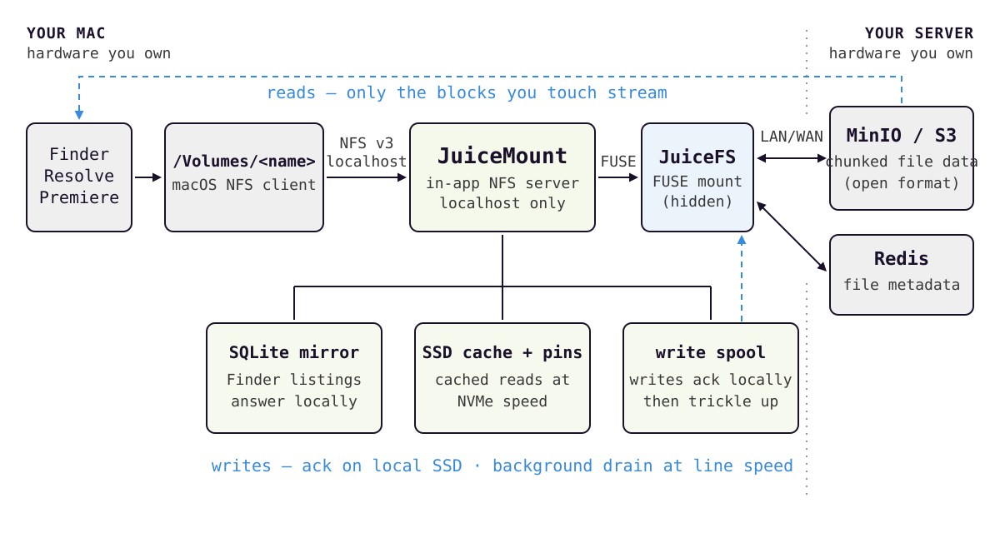

# JuiceMount

[](LICENSE)

[](https://github.com/juicedata/juicefs)


**[juicemount.com](https://juicemount.com)** · [Install](#quick-start) · [0.5 release notes](docs/release-0.5.md) · [FAQ](#faq)

**Browse and edit media from a self-hosted JuiceFS volume in Finder.** JuiceMount presents a local NFS volume backed by a local metadata database, SSD cache, write spool, and a bundled JuiceFS client. Reads fetch missing file ranges from your server. Performance depends on the project, cache state, and network.

> An open-source, self-hosted macOS client for media stored in JuiceFS.

> **Status:** beta, macOS-only, self-hosted. Version 0.5.0 is the general release, with open Finder, offline, and multi-Mac acceptance work described in the [release notes](docs/release-0.5.md).

---

## For the editor

You already know the trade you've been making.

**Cloud editing storage** (LucidLink, Suite, Shade) gives you a drive that mounts and streams beautifully, plus a per-seat, per-terabyte bill that grows with the one thing video makes most of. Your library lives inside someone else's filesystem.

**A NAS over plain SMB** is fast on the LAN and it's yours. But Finder grinds for a full minute opening a big project, there's no offline, and there's no good story the moment you leave the building.

**Sync tools** (Dropbox, Nextcloud, Seafile) have offline workflows but move whole files and are much slower than SMB. Open one shot to check focus on a 100 GB take and you wait for all 100 GB.

JuiceMount mounts a JuiceFS volume through macOS NFS, keeps resident metadata and file ranges local, and fetches missing ranges through JuiceFS. You run the Redis and S3-compatible storage behind it. Version 0.5 includes offline pinning and a local write spool, with the limits described below.

---



## Your files become blocks — that's the magic

Most tools treat a video file as one object: to touch any of it, you move all of it. JuiceMount stores every file on your NAS as 4 MB blocks ([JuiceFS](https://github.com/juicedata/juicefs)'s open, documented format), and blocks travel independently.

JuiceFS divides files into chunks and fetches the ranges an application reads. A cache hit can use local data; a miss needs the server, so the first scrub of a large file still depends on network latency and bandwidth. A fully cached range does not require a synchronous remote request under the local-serving design contract, which still needs final acceptance across the full workflow.

JuiceFS uses a documented format, so you can access the underlying volume with a stock `juicefs` client and your server credentials if you stop using the app.

---

## What editing on it feels like

- **It mounts in Finder.** `/Volumes/<name>` is a local NFS mount served by JuiceMount, with JuiceFS and macFUSE behind it. Use the same mount name on another Mac if your project relies on absolute paths; the final two-Mac workflow is still under test.

- **Search local metadata.** JuiceMount's search window uses a SQLite index on your Mac. An earlier author-run test found filenames in a library of about 131,000 entries in about 29 ms; that measurement does not cover every library or a cold index. Quick Look opens the original file through the mounted volume.

- **Pin files before disconnecting.** Pinning brings file data into the local SSD cache, and offline mode serves available metadata and cached ranges. Check that the files you need are ready before leaving the network. The complete consumer pin and offline editing workflow remains under test.

- **Track local writes.** With the write spool on, acknowledged writes stay on local storage while the background drainer publishes them to the server. Check the pending-upload count before replacing the app, disconnecting storage, or removing local data. Bounded packaged tests covered atomic publish, conflicts, cancellation, and interrupted upload; the complete outage and power-loss workflow remains open.

- **You drive it from the menu bar.** The icon shows healthy, uploading, degraded, or offline state, and the popover shows backend health and pending uploads. Check that upload count before assuming a save has reached the server.

---

## Requirements

Honest list. This is a self-hosted system, and there is a server side.

**On the Mac (client):**

- macOS 26.0 or later (the app’s minimum system version). Developed and tested on Apple Silicon; Intel builds are unverified.
- [macFUSE](https://macfuse.github.io/), required by the JuiceFS client. The first-run Setup Assistant preflight checks that it's installed and walks you through it if not.
- The pinned JuiceFS engine is bundled with the app. Setup Assistant checks its signature and version; no separate JuiceFS installation is needed.
- The bundled eject helper must be enabled and answering in **System Settings → General → Login Items & Extensions** before Start. macOS may ask for administrator approval when JuiceMount creates the mount folder; `mount_nfs` itself runs without elevation.
- For source builds: Go 1.26+ and Xcode command-line tools (Swift 5.9+). Intel builds remain unverified.

**On the server (any of these):**

- TrueNAS SCALE (the documented YAML install path, see [`server/INSTALL-TrueNAS.md`](server/INSTALL-TrueNAS.md)), or
- Any Linux box / Synology DSM 7+ / laptop with Docker + Docker Compose.
- Disk for two things: the MinIO object bucket (your actual media) and a small Redis dataset (metadata; AOF-persisted).
- A trusted LAN or private route: the authenticated RESP proxy owns port 30179, Redis itself has no published port, and MinIO serves object data on 30151. Keep them private (see [`server/README.md` § Security notes](server/README.md)).

**Network:** use a trusted connection to Redis and S3-compatible storage. A slow or interrupted link affects cache misses and pending uploads.

**Editing from outside the LAN (remote access):** supply a trusted private route to the server and select **Use existing private network** in JuiceMount. Keep Redis, MinIO, and Manager off the public Internet. The final Link routing and reconnection workflow remains under test.

---

## Quick start

### 1. Server

Follow the [0.5 server install guide](server/INSTALL-TrueNAS.md) with the release's accepted image manifest. The compose needs four published image digests, durable Manager and storage credentials, named Redis proxy principals, and host storage paths before rendering. TrueNAS users paste the rendered YAML into **Apps → Discover → ⋮ → Install via YAML**; other Docker hosts use the same canonical compose and private environment file. The [server README](server/README.md) explains the services and upgrade path.

### 2. Mac

Install macFUSE; the app includes its own JuiceFS engine:

```sh
brew install --cask macfuse           # approve the system extension if macOS asks
```

Then get the app:

**Download.** Get 0.5.0 from [Releases](https://github.com/lelanddutcher/juicemount/releases/latest) and follow the [install and upgrade notes](docs/release-0.5.md). Unzip `JuiceMount.zip` and move `JuiceMount.app` to `/Applications`. Update checks run only when you choose **Check for Updates…** in the app.

**Or build from source** (Intel builds are unverified):

```sh
git clone https://github.com/lelanddutcher/juicemount
cd juicemount
./scripts/build-app.sh                # Go c-archive + Swift app + codesign
./scripts/install.sh                  # → /Applications; --launchd is optional
```

A locally built app may launch without download quarantine, but an ad-hoc signed build cannot Start a mount: the eject helper requires a JuiceMount Developer ID signature and must be enabled. The install script requires a JuiceMount Developer ID signed bundle and refuses installation while the GUI or serving processes are running. [Check pending uploads and Stop/Quit safely](docs/release-0.5.md#upgrading-an-existing-install) first. It verifies a staged copy, retains the previous bundle and preserves failed staging artifacts; it never quits or kills processes. Use `--source /absolute/JuiceMount.app` for an existing signed release, or `--destination /absolute/Test.app` for a disposable install; `--launchd` is limited to `/Applications/JuiceMount.app`. See [signing and notarization](docs/signing.md) for distribution requirements.

On first launch the **Setup Assistant** opens automatically: it checks the bundled JuiceFS engine, macFUSE, and backend reachability, and walks you through pointing the app at your box (also reachable later via menu-bar icon → Setup Assistant…, or **Preferences → Connection**):

- **Redis URL:** `redis://<server>:30179/1` identifies the authenticated RESP proxy. Use **Request access** in Settings → Server access and wait for Manager approval before starting the mount.
- **S3 endpoint override:** `http://<server>:30151/<bucket>` (only needed if the volume was formatted with a docker-internal hostname)

The Manager delivers this Mac's Redis principal and object key after approval; the app stores them in Keychain.

Enable the bundled eject helper in **System Settings → General → Login Items & Extensions** if prompted, then hit **Start**. macOS may ask for administrator approval to create the mount folder. `/Volumes/<name>` appears in Finder; point your NLE's media browser at it and edit.

---

## Under the mount

The editor-facing half is simple: a Finder volume. The half that makes it fast is below it.

<picture>
  <source media="(prefers-color-scheme: dark)" srcset="assets/readme/arch-diagram-dark.svg">
  
</picture>

Your NLE talks to a normal Finder volume: an **NFS share served from `127.0.0.1`, tuned for the way Finder hammers metadata.** Behind it, the hot path stays on your Mac:

- **Metadata** can be answered from a local SQLite mirror. Resident entries should not require a synchronous remote request; cold entries and revalidation can still depend on the server. Earlier directory timings were measured on the author's setup, and the final Finder responsiveness gate is open.
- **Reads** use local buffers and the SSD cache when the requested range is resident, then JuiceFS and the object store when it is missing.
- **Writes** with the spool enabled land on local SSD before background publication. Keep that local state until the app reports the queue drained or you have preserved it for recovery.

Underneath all of that, **JuiceFS** breaks file data into chunks stored as S3 objects in MinIO (or any S3-compatible store), with file metadata in Redis. The hidden FUSE mount that JuiceFS needs lives at a dotfile path your NLE never browses. The object store can also be a cloud bucket (Backblaze B2, Cloudflare R2, Wasabi, anything S3-compatible JuiceFS supports), with Redis still on your box, though the self-hosted MinIO/TrueNAS path is the one this project's QA actually exercises.

Your server stores the data in JuiceFS's documented format. Keep backups of both the object store and Redis metadata, and retain JuiceMount's local spool while uploads are pending. A stock JuiceFS client can read the underlying volume independently of the app.

Full architecture, the data-safety story, and the honest limits live in [`ARCHITECTURE_juicemount.md`](ARCHITECTURE_juicemount.md) and [`MENU_BAR_APP.md`](MENU_BAR_APP.md).

---

## Performance

All numbers below were **measured by the author on his own setup** (Apple-Silicon Mac ↔ TrueNAS SCALE over 10 GbE; methodology, workload scripts, and the regression harness in [`docs/PERFORMANCE_METHODOLOGY.md`](docs/PERFORMANCE_METHODOLOGY.md)). They are honest measurements, not marketing benchmarks. Your hardware will differ.

| What | Measured |
|---|---|
| Sustained network throughput, 10 GbE LAN | ~7 Gbit/s up and down (author-measured) |
| Cached read through the full NFS path (`dd`, 200 MiB) | **226–571 MB/s**, READ p95 481 µs |
| Fully-cached 200 MiB sequential read | 431 MB/s with **4.6 MB** total network traffic |
| Pinned 350 MB file read, network off | 215+ MB/s sustained |
| Directory open, 100 K+-entry volume | 15–120 ms (3–10 s through raw FUSE) |
| Filename search across ~131 K entries | ~29 ms |
| Un-pinned read refusal in offline mode | 4–67 ms (vs. a 30 s NFS retry hang) |

These are author-run measurements from earlier builds and workloads, not a speed guarantee for the 0.5 checkpoint. The recent packaged build passed bounded Finder copy and directory checks, while the full Finder, slow-link, and SSD-pin acceptance remains open.

---

## What JuiceMount is not

Stating this up front saves everyone time:

- **Not a SaaS.** No hosted offering, no accounts, no billing. You run the server.
- **Not a review platform.** No browser viewer, comments, or approvals. Frame.io and friends own that lane and pair fine with this.
- **Not AI media search.** Filename search uses the local index; content-aware search is on the roadmap.
- **Not multi-OS.** macOS only today. The server side runs anywhere Docker does.
- **Not a backup.** It's primary storage with a cache. Run real backups of the MinIO bucket and Redis. The Manager has backup-scheduling tooling, but the 3-2-1 discipline is yours.
- **Not zero-ops.** A failed disk on your NAS is your failed disk. That's the deal that makes it free.

---

## Roadmap

Version 0.5 has open acceptance work across full Finder and offline workflows, Link recovery, deployed proxy processing, and consumer pinning. See the [release notes](docs/release-0.5.md).

**Earlier releases**

- **Offline groundwork.** The app can use available local metadata and cached ranges without the server, refuses missing reads while offline, and warns when a pinned set exceeds available disk. The full checkpoint workflow remains under test.
- **Snappier pinning** with a live "scanning…" state, and a menu-bar that recovers correctly after a network blip instead of getting stuck on "disconnected."
- **A cleaner Settings pane** and a Manager web UI trimmed of dead readouts.

**Next up**

1. **One-step server setup.** Today the biggest friction is standing up the NAS side. The next big sprint is a guided, near-one-click install: a first-class TrueNAS app and a single-command bring-up for any Docker host, so getting from "I have a NAS" to "my editors are mounting it" doesn't require hand-editing compose files.
2. **Deeper search.** Filename search is instant today. Next is searching across more than names: richer metadata, and eventually content-aware search.
3. **Teams, done safely.** Multi-editor support with real collision handling: cooperative file locking so two people can't clobber the same project, presence ("who has this open"), and a simple admin tool to add people and hand out **editor** or **viewer** seats.
4. **A web interface.** A browser-based file manager for the volume (browse, upload, share links), most likely built on a proven open-source file browser rather than reinventing one.
5. **Remote access.** Bring a trusted private route from the Mac to the NAS. Keep Redis, MinIO, and Manager off the public Internet; final Link routing and recovery checks remain open.

**Exploring**

- Codec-aware Quick Look proxies (R3D / ARRI / BRAW / ProRes RAW).
- Content-hash backup verification with a traffic-light inventory.
- Bandwidth-aware automatic offline/streaming switching.

---

## FAQ

**What happens when the NAS is off, or I'm on a plane?**

Pin what you need first (popover → *Pin Folder for Offline…*, or Finder right-click → Services → *JuiceMount: Pin for Offline*) and wait for the app to show that those files are ready. Offline mode uses available metadata and cached ranges; missing data cannot load while the server is unreachable. Earlier bounded recovery tests passed, but the full pin and disconnected editing workflow still needs acceptance.

**What happens to my writes if the network drops or the server dies mid-copy?**

The write spool is on by default and can be changed in Preferences → Cache & Storage. The popover shows pending, active, stalled, and failed uploads. Let them drain before an upgrade, or preserve the local spool and metadata for recovery; never remove either because a Finder copy has completed. If you disable the spool, writes depend on the server at the time of the save. Offline-files mode controls reads, not the safety of unspooled writes.

**Can two Macs mount the same volume?**

The design gives each Mac the same mount path when you use the same volume name, and both clients use the shared server metadata. The final two-physical-Mac lease and simultaneous editing workflow has not passed acceptance, so treat concurrent project edits as unverified.

**Is my data locked in?**

No. Your bytes are on your hardware — copy them from the mounted volume, or `juicefs sync` them out; the bucket stays under your control. In the bucket, file data lives in JuiceFS's open, documented chunk format, and the volume is a standard JuiceFS volume (the server stack formats it with stock `juicefs format`), so the stock `juicefs` client can mount it with no JuiceMount involved. <!-- standard-volume claim: server/INSTALL-TrueNAS.md runs stock juicefs format -->

**How much disk does the cache use?**

You set the cache size in Preferences → Cache & Storage; JuiceMount grows the cache only as far as needed to keep your pinned content fully cached, and clamps it so the boot disk always keeps at least 10 GiB free. It also reclaims APFS purgeable space — mostly Time Machine local snapshots — at mount time and on demand via the popover's *Reclaim* button. When you leave, `scripts/uninstall.sh` shows the size of everything it would delete before touching anything; the JuiceFS chunk cache is usually the big one (it can be hundreds of GB).

<details>
<summary><strong>Why an NFS loopback server instead of using FUSE directly, or a File Provider extension?</strong></summary>

Finder asks for a lot of metadata, so JuiceMount serves resident entries from a local SQLite mirror through localhost NFS. JuiceFS still uses a hidden FUSE mount behind that server. Apple previewers read original files; the bundled thumbnail extension does not replace Apple's handling of file types it already covers. [`docs/no-fileprovider.md`](docs/no-fileprovider.md) explains why this app avoids File Provider.

</details>

<details>
<summary><strong>What exactly is the relationship to JuiceFS?</strong></summary>

JuiceMount is built on JuiceFS and says so loudly (see the credit section below and [`NOTICE`](NOTICE)). JuiceFS solved the distributed-filesystem problems — chunked object layout, the Redis metadata engine, cache management — and JuiceMount adds the macOS experience layer: the Finder-tuned NFS re-export, the SQLite metadata cache, pinning and offline gates, the write spool, the menu-bar app, and the server packaging. The app runs a pinned, patched `juicefs` binary bundled beside its executable, and checks that its signature and version match the app. If your problem isn't video-on-macOS, use JuiceFS directly — it's excellent.

</details>

<details>
<summary><strong>Does it phone home?</strong></summary>

No background connection phones home. The app's automatic network activity is limited to the Redis and S3 endpoints you configure plus a loopback control plane on `127.0.0.1`. JuiceFS's anonymous usage reporting is explicitly disabled with `--no-usage-report`; there is no crash reporting or analytics. The only exception is the explicit **Check for Updates…** command, which contacts the signed GitHub release feed when you click it. Diagnostics remain a local zip you create and choose whether to share. <!-- verified: health/fuse.go; Info.plist SUEnableAutomaticChecks=false; MenuBarController starts Sparkle only in checkForUpdates() -->

</details>

<details>
<summary><strong>Does it run on Intel Macs?</strong></summary>

Untested, honestly. Development and testing are on Apple Silicon; an Intel source build has not been verified. The app requires macOS 26.0 or later on either architecture. If you try it, a report — success or failure — is a genuinely useful contribution.

</details>

---

## Troubleshooting

The popover's health rows (Redis / MinIO / FUSE / NFS mount) are the first thing to check — most fixes start there. Deeper app-side detail lives in [`MENU_BAR_APP.md`](MENU_BAR_APP.md).

**The volume doesn't appear in Finder.** Open the popover: if the NFS row says "Volume not mounted", click **Mount Now** to retry the ordinary NFS mount; administrator approval may be needed only when JuiceMount explicitly creates the mount folder. (Scriptable as `/mount-now` on the control plane.) Also check that something else doesn't already own the path: `mount | grep <volume-name>`.

**Finder says "not responding", or the icon turns amber.** Amber means degraded: running, but a backend (Redis / MinIO / FUSE / NFS) is unhealthy or recovering — the popover names which one and why. Give it a moment: the health monitor force-remounts a wedged FUSE daemon once the backend is reachable again, and an independent watchdog keeps the menu-bar state converging on reality instead of sticking. If the kernel mount itself is wedged — server died, every Finder access hangs — **Force Eject** in the popover is the last resort: a privileged kernel-level unmount behind a confirmation dialog. <!-- self-heal story: health/monitor.go watchdog + ServerController recovery watchdog; Force Eject: MenuPopoverView.swift -->

**Uploads look stuck.** With the spool enabled, the popover's *Pending uploads* section shows pending / in-flight / stalled / failed counts with per-entry age and last error; **Retry failed** and **Recover stalled** act on them directly. A full spool surfaces to Finder as "disk full" rather than a mystery error.

**Where logs live.** Structured JSON at `~/Library/Logs/JuiceMount/juicemount.log` (16 MB × 5 rotation); `tail -f … | jq .` for live debugging. For a bug report, use **Export Diagnostics…** (in the popover and in Preferences → Maintenance): it bundles logs, the mount table, and backend health into a local zip — nothing is sent anywhere.

**Uninstalling.** `./scripts/uninstall.sh` stops the app, unmounts, shows exactly what it will remove with sizes, and asks once. One warning worth repeating from the script itself: if the write spool still holds files, those are uploads that never reached the server — deleting them loses data, so that step requires its own explicit confirmation. It deliberately leaves the app bundle, the `juicefs` binary, macFUSE, and everything on your server alone; `--dry-run` previews the whole plan.

---

## Built on JuiceFS — credit where due

JuiceMount exists because [JuiceFS](https://github.com/juicedata/juicefs) (Apache-2.0, by [Juicedata](https://juicefs.com)) solved the hard distributed-filesystem problems — chunked object layout, Redis metadata engine, cache management — and proved them in production for years. JuiceMount is a macOS-native experience layer on top: the Finder-tuned NFS re-export, metadata caching, pinning, offline gates, the write spool, the menu-bar app, and the server packaging. The NFS server is a fork of [`willscott/go-nfs`](https://github.com/willscott/go-nfs) (Apache-2.0), vendored at `internal/nfs` and attributed in [`NOTICE`](NOTICE).

If JuiceFS itself fits your (non-video, non-macOS) problem, use it directly — it's excellent.

## License

[Apache License 2.0](LICENSE). Third-party attributions (JuiceFS, go-nfs, go-nfs-client) are in [`NOTICE`](NOTICE); JuiceFS and go-nfs are likewise Apache-2.0, go-nfs-client is BSD-2-Clause.

## Contributing

- **Bugs:** open an issue with the diagnostic zip (menu-bar → Export Diagnostics) — it bundles logs, mount table, and backend health.
- **Code:** one theme per PR — stability fixes never share a commit with features. Run `go vet ./...` and `go test -race` on touched packages; request-path changes get an adversarial review pass.
- **Testing on real hardware** is the most valuable contribution: different NAS vendors, network shapes, and NLE versions. Real Finder/Resolve/Premiere testing beats synthetic checks — that rule is earned.
- **Developer setup** (local test workflows, headless CLI, config reference): [`docs/dev-setup.md`](docs/dev-setup.md).

*Non-negotiables, so you don't waste a PR:* no telemetry without opt-in, no proprietary dependencies for self-hosters, no FileProviderExtension (ever — [`docs/no-fileprovider.md`](docs/no-fileprovider.md) is the postmortem), reliability beats novelty.
